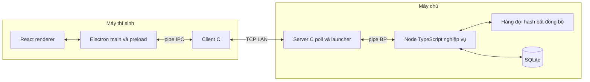
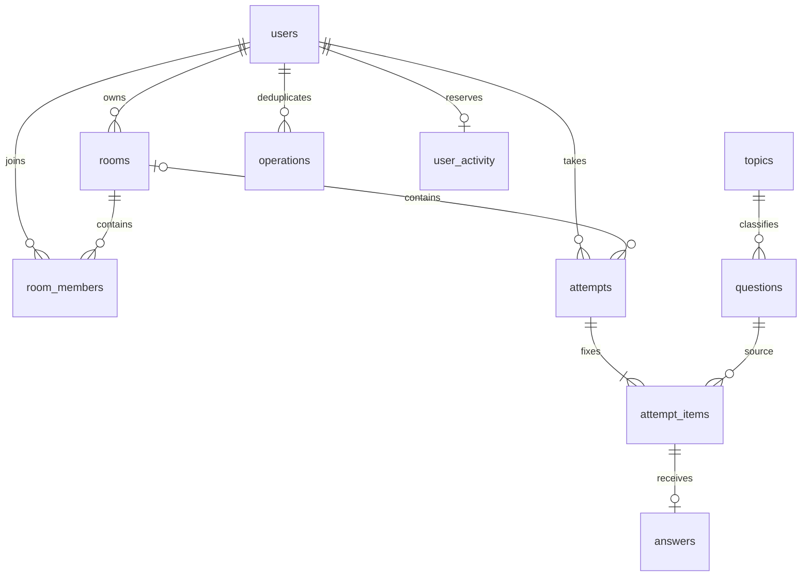

# 02. Kiến trúc và dữ liệu

Nhóm 4 — Nguyễn Minh Quân (20235816), Đặng Hoàng Quân (20235813).

**Trạng thái v2.0, quyết định chuyển nghiệp vụ sang TypeScript ngày 15/11/2026.**
Nhóm 4 chốt TCP client/server bằng C, nghiệp vụ và SQLite trong một tiến trình
Node.js/TypeScript trên máy chủ. Quyết định M01 thay K01/K04/K06 về nơi thực thi.
Yêu cầu nghiệp vụ D01–D07 và C01–C12 được triển khai theo hợp đồng hiện hành.

Review chéo ngày 17/11/2026 tại [báo cáo 5 tài liệu](research/five-document-consistency-review.md):
giữ kiến trúc M01, phân biệt ngân sách byte với RSS và các mục phải chốt trước module liên quan.

## 1. Phạm vi và môi trường

React/TypeScript chạy trong Electron trên máy thí sinh. Electron quản lý client C
qua pipe riêng. Client C có một kết nối TCP tới server C trên LAN. Server C khởi
chạy một Node business child qua pipe riêng và chuyển lệnh/kết quả theo BP.

Mục tiêu đo là 50 thí sinh hoạt động theo tài liệu 04. Nền tảng hiện có build C,
desktop và business workspace --version. Bước tích hợp M1 sẽ triển khai các pipe,
TCP và routing. Nghiên cứu poll/SQLite trước M01 được giữ với ngày/baseline gốc.

## 2. Sơ đồ tổng thể



## 3. Trách nhiệm và nguồn trạng thái

| Thành phần | Trách nhiệm và dữ liệu sở hữu |
| --- | --- |
| React/preload | Form, component, current selection, API chức năng và trạng thái hiển thị. |
| Electron main | Client C lifecycle, pending RAM, instance fence và bridge UI. |
| Client C | TCP connect/reconnect, framing/RX/TX/heartbeat và token resume trong RAM. |
| Server C | accept/poll, frame/envelope, RX/TX caps, connection ID/generation, hello/ping, pipe/Node lifecycle và route completion. |
| Node dispatcher | Auth/session/binding, quyền, phòng/roster/activity, deadline, kho/đề/bài/result, operation receipts, một kết nối SQLite. |
| Hash queue trong Node | Băm/verify qua API crypto bất đồng bộ, 64 job chờ và một job đang chạy. Callback đưa kết quả vào dispatcher để kiểm tra lại ticket/version/binding. |

Nghiệp vụ được viết TypeScript trong apps/business. Kết nối LAN được mở và phục
vụ bằng C ở src/client và src/server. Kết quả auth được Node chuyển cho C bằng
control BP để C quản lý trạng thái transport đã xác thực và lọc completion cũ.
Node quyết định quyền từng yêu cầu tại thời điểm xử lý. NET body không được tự
thêm user_id/role để chọn người gọi; khóa ngoài schema bị từ chối. Caller lấy từ
binding/session Node, metadata kết nối BP do C cấp. Các API main/preload có whitelist riêng.

## 4. Cầu nối Electron–client C

### 4.1. Tạo và sử dụng kênh

Electron main khởi chạy đúng binary client C đóng gói cùng ứng dụng, bằng
`spawn()` bất đồng bộ với `shell: false` và các đối số riêng biệt. Cấu hình
`stdio: ['pipe', 'pipe', 'pipe']` để giữ các đầu kênh của tiến trình con:

- stdin của client C: nhận lệnh từ Electron main.
- stdout của client C: chỉ phát phản hồi/sự kiện có định dạng.
- stderr của client C: chẩn đoán đã lọc bí mật; Electron phải đọc liên tục hoặc
  xử lý theo chính sách log có giới hạn.

Không đưa mật khẩu/token vào command-line, biến môi trường hoặc log. Không dùng
shell ghép lệnh người dùng; không dùng API đồng bộ làm treo Electron main.

Đây là IPC giữa tiến trình cha/con, không phải kho lưu trữ. Node.js hỗ trợ cấu
hình stdio này và lưu ý kênh có dung lượng hữu hạn, tiến trình con có thể bị chặn
khi output không được tiêu thụ. [Nguồn: Node.js child_process](https://nodejs.org/api/child_process.html#optionsstdio).

### 4.2. Đóng khung và luồng dữ liệu

K02 dùng cùng bộ codec C cho framing ở pipe và TCP: header độ dài cố định
và payload JSON UTF-8. Hai kênh vẫn có tập lệnh và xác thực khác nhau; không tự
chuyển mọi JSON từ renderer tới server. Độ dài tính theo byte, không theo số ký tự.
Thông số header và giới hạn ở tài liệu 03. V01 được nhóm chốt ngày 17/11/2026:
giữ length + JSON, không thêm CRC32 bản đầu. Header/caps hiện hành không đổi.

- Tích lũy dữ liệu nhận thiếu, tách nhiều frame trong một lần đọc; không mặc định
  một lần đọc hoặc một lần ghi là một message.
- Đọc/ghi không chặn ở client C; có buffer, offset, queue và giới hạn tương tự TCP.
- Nếu dùng C stdio, phải chủ động xử lý buffering/flush; ưu tiên một đường I/O
  bằng descriptor để không trộn hai cơ chế ghi lên cùng stdout.
- Electron theo dõi kết quả `write()` và chờ `drain` khi cần; không tích lũy vô hạn.
- `highWaterMark` không phải hard cap RAM; áp dụng giới hạn byte của ứng dụng cho
  cả frame và queue trong Electron. [Nguồn: Node streams](https://nodejs.org/api/stream.html#buffering).
- Client C vẫn tiếp tục xử lý socket/timer khi cầu nối chậm; quá giới hạn thì báo
  lỗi/đóng có kiểm soát, không để buffer tăng không giới hạn.
- JSON đề trả cho UI chỉ chứa dữ liệu người thi được xem. Token resume giữ ở
  client C; không cần chuyển token đó lên React.

### 4.3. Ranh giới tin cậy

Renderer chỉ được gọi các hàm cụ thể như đăng nhập, tham gia, lưu đáp án, nộp bài.
Preload không xuất toàn bộ `ipcRenderer` hoặc quyền thực thi lệnh. Electron main
kiểm tra nguồn IPC và schema dữ liệu; bật `contextIsolation`, renderer sandbox,
tắt `nodeIntegration`, giới hạn navigation và chỉ tải UI đóng gói. Những kiểm tra
này không thay thế phân quyền server. [Nguồn: Electron Security](https://www.electronjs.org/docs/latest/tutorial/security).

Pipe riêng không được quảng bá là chống hook hoặc chống gian lận. Người kiểm soát
máy client có thể can thiệp chương trình; server không gửi đáp án đúng trong luồng
thi. Kênh TCP thuần cũng không mã hóa mật khẩu/token trên LAN. K07 xác định
baseline demo trên LAN kiểm soát; TLS chưa nằm trong cam kết, không gọi đây là
thiết kế sẵn sàng triển khai thi thật trên mạng không tin cậy.

## 5. Mô hình chạy máy chủ — K01 theo M01

### 5.1. C reactor và Node business process

Server C là tiến trình cha. A triển khai POSIX spawn/exec Node và pipe, thêm pipe
read/write vào cùng vòng poll nonblocking với TCP. B triển khai encoder/TX/routing.
Node nhận command trong apps/business/bridge và chuyển vào dispatcher có giới hạn.
Một handler nghiệp vụ chạy tới xong transaction trước khi handler tiếp theo bắt
đầu. Dispatcher nhường event loop sau từng command để nhận pipe/control/hash.

SQLite DatabaseSync chạy đồng bộ trên Node. Transaction ngắn và các trang đề tối
đa 5 items giúp giới hạn thời gian giữ dispatcher. Độ trễ DB có thể làm timer và
pipe Node chậm, vì vậy C vẫn đo timeout/queue, còn Node kiểm tra deadline ngay
trước mutation. Theo dõi event-loop lag và commit latency khi kiểm thử.
[Nguồn Node 24 SQLite](https://github.com/nodejs/node/blob/v24.15.0/doc/api/sqlite.md).

Hash dùng node:crypto.scrypt bất đồng bộ, mỗi lúc một job. Callback chỉ enqueue
completion, dispatcher kiểm tra ticket/account version/authority rồi mới cấp
phiên. Transaction DB luôn kết thúc trước khi chờ hash hoặc write/drain pipe.
Mỗi job có deadline, kết quả hoàn tất muộn phải được xét ticket còn hiệu lực.

### 5.2. Queue, timer và credit

SCRUM-9 cụ thể hóa interface/counter tại
[hợp đồng nền](planning/shared-interface-contracts.md#4-bp--ticket-counter-và-thời-điểm-chuyển-ownership).
Đây là bàn giao thiết kế chờ review, không phải BP runtime đã kiểm chứng.

Command/completion mỗi chiều có trần hạch toán tại mỗi đầu 1024 phần tử/8 MiB:
960 slots/7.5 MiB thường và 64 slots/512 KiB control cục bộ trong tổng.
Credit thường end-to-end khác counter buffer control độc lập tại sender/receiver;
hai đầu có thể cùng giữ control, dự toán riêng ở 04 §5.2. Không thêm ACK control.
Mỗi connection tối đa 8 request thường đang chờ.
BP framing/credit/ownership được chốt tại tài liệu 03 §18. C giữ credit cho phản
hồi trước khi chuyển request vào pipe. Node encode một kết quả đã commit vào
completion queue được giữ chỗ, chuyển ownership output cho C khi C đọc frame hoàn chỉnh.
Request ticket/credit chỉ được giải phóng khi output đã chuyển vào TCP TX hoặc
bị loại đúng generation theo 03 §18.4; đọc pipe xong chưa tự chứng minh credit đã được trả.

Node dùng process.hrtime.bigint() cho deadline monotonic và Date.now() cho UTC.
Trước mỗi command, dispatcher chạy các timer đã tới hạn. Khi rảnh, setTimeout
đánh thức để kiểm tra lại monotonic deadline. Khi event loop bị chậm, điều kiện
xét hạn C07 vẫn khóa các write nhận muộn. Điều kiện C02 và C07 áp dụng tại Node.

Đợt phát đề dùng room.changed nhỏ và client kéo trang. Response/event tuân theo
credit, client chậm bị C timeout/đóng, dữ liệu đã commit được lấy lại qua sync.
C poll, Node callback và dispatcher đều có giới hạn công việc mỗi lượt để xử lý
control kịp thời. Thời gian và thứ tự byte mỗi pipe được giữ trong FIFO.

### 5.3. Danh tính và authority

C cấp connection_id tăng đơn điệu trong server instance và generation, ghi nhận
peer IP từ accept. Node nhận opened trước request, closed sau request đã chuyển
trên cùng FIFO. Socket fd được giữ trong C. Node gắn user/binding_epoch với
connection context do bridge cấp. Trước mutation và auth completion Node xét lại
context, phiên, epoch, quyền và deadline.

Completion BP mang target connection_id/generation và authority epoch. C đối
chiếu với mapping hiện hành. Login/resume/logout terminal response đi theo ticket
request để ACK logout vẫn được gửi sau revoke. Control binding update được đưa
trước các domain event của binding mới. Nếu control không chuyển được trong
ngân sách dự phòng thì đóng kết nối bị ảnh hưởng hoặc dừng server có kiểm soát.
Chi tiết message/thứ tự ở tài liệu 03 §18.

### 5.4. Quyền sở hữu dữ liệu qua pipe

| Dữ liệu | Owner và vòng đời |
| --- | --- |
| Socket/RX/TX và BP buffer C | Reactor cấp phát, chuyển/giải phóng rõ theo frame và byte credit. |
| NET request đã nhận | C giữ cho tới khi chuyển đủ frame BP, Node giữ bản parse tới hết xử lý. |
| Cây cJSON | Luồng parse C giải phóng sau validate/encode hoặc lỗi. |
| Object TypeScript | Bridge/dispatcher giữ theo cap. Secret có vòng đời ngắn và được lọc khỏi log. |
| SQLite statement/rows | Node storage, row ra DTO có quyền trước serialize. |
| Password/hash job | Node auth queue, callback trả dispatcher, Buffer chứa password được xóa khi có thể. JS string và GC có giới hạn xóa bộ nhớ cần ghi nhận. |

### 5.5. Admission

C kiểm tra cap kết nối/frame/NET in-flight/TX và credit BP. Node kiểm tra quyền,
50 reservation, tài nguyên DB/ledger và rate auth theo C08. C cung cấp peer IP
thực cho Node. Node gửi control trạng thái xác thực cho C, C duy trì cap 64 TCP
chưa xác thực. Cấp slot/hash không tạo reservation, reservation được commit ở
transaction create/join/practice. Normal/restricted policy ở tài liệu 04 §5.3.

## 6. Client C và vòng đời ứng dụng

Client C có một vòng I/O xử lý đồng thời stdin, stdout có dữ liệu chờ, socket TCP
và timer. Minh Quân sở hữu luồng kết nối/nhận, Hoàng Quân sở hữu queue gửi, tích
hợp cùng vòng lặp. Không tạo hai reader cạnh tranh trên một socket hoặc pipe.

```text
Mở Electron → khởi chạy C → C sẵn sàng → kết nối TCP → chưa xác thực
→ đăng nhập → lấy trạng thái server → phòng chờ/làm bài/kết quả
```

- Mất TCP: UI báo gián đoạn; C reconnect có backoff/giới hạn, không reset dữ liệu
  server. Nếu token còn hợp lệ thì resume; nếu không thì yêu cầu đăng nhập lại.
- Resume thành công: lấy snapshot trạng thái, đáp án/revision và deadline; rồi mới
  quyết định yêu cầu nào được gửi lại. Không đẩy toàn bộ lựa chọn local đè lên server.
- C chết: Electron đánh dấu yêu cầu chưa có kết quả là chưa rõ, hiển thị lỗi và
  cho khởi chạy lại có giới hạn. Token RAM mất thì đăng nhập lại; không restart
  liên tục hoặc tự báo những yêu cầu đang chờ là thất bại chắc chắn trên server.
- Renderer reload: Electron main/C có thể còn chạy; UI lấy lại trạng thái qua API
  giới hạn thay vì tạo thêm một C hoặc TCP song song.
- Đóng Electron: đóng kênh, cho C thời gian thoát rồi dừng nếu cần. C phát hiện
  stdin EOF thì dọn socket/queue và thoát. Đóng app không gửi lệnh rời/nộp tự động.
- Đăng xuất: chỉ báo đã đăng xuất phía server khi có xác nhận. Khi không có mạng,
  có thể xóa token local nhưng phải nói chưa xác nhận thu hồi phiên server; đề thi
  và đồng hồ vẫn theo trạng thái server. Không giữ mật khẩu để tự đăng nhập lại.

C03 đã chốt: reconnect khôi phục dữ liệu đã commit trên server. Phản hồi bị mất
không chứng minh commit thất bại. Pending RAM chỉ sống cùng tiến trình giữ nó;
không thêm file/local DB offline draft trong bản đầu. C05 bổ sung API preload đọc pending RAM ở main; không thêm durable storage.
Quy tắc tối thiểu của C04–C06 được mô tả ngay dưới đây.

### 6.1. C04–C06 — phạm vi tối thiểu đã duyệt

- C04: main/C giữ server_instance_id trong context của W đã tiếp nhận. Hello
  trả instance khác thì dừng replay tự động của các W cũ, yêu cầu login và lấy
  state server. Không mang op sang dataset khác chỉ vì integer resource ID trùng.
  Không xóa dữ liệu server hoặc tuyên bố mọi W cũ thất bại. Pending instance cũ
  không giữ UI bị khóa chờ vô hạn: hiển thị cần đối chiếu, không chuyển thành W
  mới tự động. Chưa thêm database UUID hay phục hồi ca crash.
- C05: main giữ registry giới hạn theo pending cap hiện có, chỉ các yêu cầu đã
  tiếp nhận còn PENDING/UNKNOWN; không giữ mọi click chưa gửi. Preload có API đọc
  snapshot và subscription thay đổi đã lọc, chỉ current user/context, không token/
  password. Reload renderer đọc pending + trạng thái server; vùng bài chưa sync
  không nhận sửa mới. Main là nguồn pending local, SQLite là nguồn đáp án bền.
- C06: logout intent chặn thao tác thi mới và auto-resume cũ ngay. Online gửi
  auth.logout trong timeout hiện có; sau response/timeout/offline xóa token và
  đóng TCP cũ, về màn login. Không queue logout nền; login lại dùng TCP mới.
  Server chỉ báo revoke khi đã thực hiện; mất ACK/offline là chưa xác nhận server.
  Dọn dữ liệu UI/pending cũ khỏi context được renderer user mới đọc, completion cũ
  không gắn sang user mới. Việc đó không hủy/rollback W đã được gửi đến server.

Auth terminal response login/resume/logout được routing theo ticket/request và
connection generation của chính nó, dù transition vừa đổi/revoke session. Không
áp bộ lọc “session cũ phải còn hiệu lực” khiến chính response logout bị bỏ. Điều
này không cho phép domain response user cũ đi vào binding/user mới.

## 7. Phiên, quyền và thời gian — K03

### 7.1. Phiên khác với bài làm

Node dispatcher giữ session trong RAM: `session_id`, `user_id`, hash token, hạn hiệu
lực, session epoch, binding kết nối hiện hành. Token ngẫu nhiên do server tạo,
client C giữ bản gốc trong RAM. Không lưu token thô vào SQLite hoặc log.

- Đăng nhập mới: xác thực trước, rồi thay phiên cũ; cập nhật quyền và binding.
- Resume: kiểm tra token/hạn/epoch, chuyển binding sang kết nối mới và thu hồi
  quyền kết nối cũ. Lệnh cũ đang chờ được kiểm tra lại authority khi dispatcher xử lý.
- Một lệnh được xử lý hợp lệ trước thao tác thay phiên vẫn có thể commit; thay
  phiên không có nghĩa hoàn tác hành động đã được chấp nhận trước đó.
- Đăng xuất đã xác nhận: revoke phiên; giữ nguyên bài, thành viên và deadline.
- Phiên hết hạn: có thể đăng nhập lại và lấy bài theo `user_id` đã xác thực; bài
  không thuộc vòng đời của token. Không cần token cũ để chứng minh quyền sở hữu bài.

Chính sách TTL/sliding renewal, chống đăng nhập dồn và heartbeat được đặt ở tài
liệu 3–4. Không để heartbeat đơn thuần gia hạn một phiên đã revoke. Restart server
làm mất phiên RAM: phải đăng nhập lại, không coi token trước restart còn hợp lệ.

### 7.2. Hai loại đồng hồ

- Lưu mốc UTC theo Unix milliseconds cho lịch sử và dữ liệu trao đổi.
- Trong lần chạy server, dùng đồng hồ monotonic cho thời lượng/deadline để chỉnh
  đồng hồ hệ thống không vô tình kéo dài bài. Thời gian monotonic không dùng để
  khôi phục sau restart hoặc gửi như thời gian tuyệt đối cho client.
- Khi bắt đầu, Node dispatcher tạo cặp mốc UTC/monotonic; mọi bài cùng phòng dùng chung
  deadline đó. Client nhận thời gian server và thời lượng còn lại để hiển thị.
- Quyền sửa được xét ngay trước thay đổi nghiệp vụ trong Node dispatcher. Lệnh chờ queue
  qua hạn bị từ chối dù client click hoặc reactor nhận frame trước hạn, đúng D05.
- Chấp nhận sửa trước hạn rồi commit hoàn thành sau hạn không phải nhận một thao
  tác mới sau hạn. C07 chốt mốc monotonic sau validation/receipt lookup, ngay
  trước mutation mới bên trong transaction; phải nhỏ hơn deadline. BEGIN hoặc
   validation đi qua hạn không được dùng mốc dispatcher-entry cũ để nhận write.
  State/deadline trước revision; receipt cũ đúng quyền được xét trước state/deadline.
  Các nhánh lỗi/save/submit dùng chung bảng tài liệu 03 §10.4.

## 8. SQLite và quyền sở hữu dữ liệu — K04

**Đã duyệt lựa chọn database:** giữ SQLite cho máy chủ C transport + Node nghiệp vụ, mục tiêu
50 thí sinh hoạt động đồng thời; chưa chuyển sang PostgreSQL. Đây là lựa chọn thiết
kế, chưa phải kết quả đo năng lực. K04 chốt một Node dispatcher sở hữu kết nối SQLite,
WAL/FULL/FK, mô hình dữ liệu logic và các ranh giới transaction bên dưới.

Trước khi cân nhắc đổi database, đo độ trễ commit, thời gian chờ nghiệp vụ và tải
dồn lúc phát đề/nộp bài. Chỉ đánh giá chuyển đổi khi xác định DB là điểm nghẽn hoặc
phạm vi cần nhiều worker/server cùng ghi; đổi DB không tự loại bỏ điểm nghẽn của
một dispatcher xử lý nghiệp vụ tuần tự.

### 8.1. Cách truy cập

Một file trên ổ đĩa local server, một kết nối SQLite do Node dispatcher sở hữu. Không mở
file qua network filesystem và không cho renderer/client truy cập trực tiếp.
Dùng prepared statement, bind tham số, transaction ngắn và xử lý mã lỗi.

Khi chọn dependency, pin SQLite có bản sửa WAL-reset (3.51.3 trở lên hoặc backport
đã được xác nhận), không lấy bản Python hệ thống trong probe làm baseline triển
khai. Rủi ro được SQLite mô tả liên quan nhiều connection ghi/checkpoint; mô hình
một connection hiện tại không phải tình huống đó. Xem phần phiên bản trong
[báo cáo nghiên cứu](research/architecture-feasibility.md).

Cấu hình baseline khi mở DB:

```sql
PRAGMA foreign_keys = ON;
PRAGMA journal_mode = WAL;
PRAGMA synchronous = FULL;
```

Đọc lại giá trị để kiểm tra cấu hình thật sự có hiệu lực. WAL vẫn chỉ cho một
writer tại một thời điểm; không phải giải pháp biến SQLite thành nhiều writer
song song. Với một dispatcher, lợi ích concurrency chưa phải trọng tâm; vẫn phải đo
chi phí commit/checkpoint. [Nguồn: SQLite WAL](https://www.sqlite.org/wal.html).

Bật foreign key trên kết nối, không dựa vào mặc định. Dùng `FULL` làm baseline
để ưu tiên độ bền của các ghi đã xác nhận; không đổi sang chế độ nhanh hơn chỉ để
cải thiện số đo mà không đánh giá độ bền. Cam kết còn phụ thuộc filesystem/thiết
bị, không bảo đảm sống sót mọi sự cố phần cứng.
[Nguồn: SQLite foreign keys](https://www.sqlite.org/foreignkeys.html),
[SQLite PRAGMA synchronous](https://www.sqlite.org/pragma.html#pragma_synchronous).

### 8.2. Kiểu và quy ước

- Khóa nội bộ: integer ID; các ID không phải bí mật, không thay thế phân quyền.
- Username chuẩn hóa ASCII theo một quy tắc duy nhất trước UNIQUE; tên hiển thị
  và nội dung câu hỏi dùng UTF-8. Quy tắc độ dài/ký tự sẽ chốt ở giao thức.
- Boolean dùng integer có CHECK 0/1; enum dùng TEXT và CHECK tập giá trị.
- Mốc thời gian lưu INTEGER milliseconds; không lưu chuỗi ngày theo locale.
- Độ dài văn bản và số câu đều bị giới hạn từ đầu; không chỉ dựa vào UI.
- `total_count > 0`, số lượng từng độ khó không âm; tổng bằng số câu cấu hình.
- Không lưu điểm làm tròn làm căn cứ chấm: giữ `correct_count` và `total_count`.
- Không xóa cứng tài khoản/chủ đề/câu hỏi có tham chiếu trong v1; dùng trạng thái.

### 8.3. Mô hình quan hệ logic

Đây là bảng thiết kế, chưa phải migration SQL chạy được. DDL khi triển khai phải cụ thể
hóa mọi NOT NULL, CHECK, FK, index và transaction bên dưới.

| Bảng | Trường chính | Ràng buộc và mục đích |
| --- | --- | --- |
| `users` | id, username_key, display_name, password_hash, auth_version, role, active, created_at | UNIQUE username_key; role USER/ADMIN. password_hash là chuỗi băm có salt/tham số. auth_version tăng khi đổi thông tin xác thực/quyền, để loại kết quả hash cũ. |
| `topics` | id, name, name_key, active, version, created_at, updated_at | UNIQUE name_key theo quy tắc chuẩn hóa được đặc tả trước migration; không dựa vào LOWER ASCII để coi là chuẩn hóa mọi Unicode. Ngừng dùng không xóa tham chiếu cũ; version phục vụ cập nhật đồng thời. |
| `questions` | id, topic_id, difficulty, prompt, option_a/b/c/d, correct_option, active, version, updated_by, updated_at | FK topic/user; difficulty EASY/MEDIUM/HARD; correct_option A/B/C/D. Sửa tăng version. |
| `rooms` | id, owner_id, name, topic_id nullable, easy_count, medium_count, hard_count, duration_seconds, capacity, config_version, state, created_at, waiting_expires_at, cancelled_at, cancel_reason, started_at, deadline_at, ended_at | topic NULL nghĩa tất cả; state WAITING/RUNNING/ENDED/CANCELLED; capacity 50. started/deadline bắt buộc khi RUNNING. config_version tăng khi đổi cấu hình, không tăng vì presence/membership. |
| `room_members` | room_id, user_id, joined_at | PK (room_id,user_id), FK room/user; xóa chỉ khi thành viên thường rời lúc WAITING. Không xóa do mất mạng. |
| `user_activity` | user_id, room_id nullable, practice_attempt_id nullable | PK user_id, CHECK đúng một tham chiếu khác NULL. Giữ chỗ hoạt động theo K05 để ngăn hai phòng cùng gán bài cho một người. |
| `attempts` | id, user_id, room_id nullable, kind, state, cấu hình số câu/chủ đề/thời lượng, started_at, deadline_at, finalized_at, finalize_reason, correct_count, total_count | kind EXAM/PRACTICE; state OPEN/FINALIZED. EXAM cần room_id, PRACTICE không có. UNIQUE (room_id,user_id); một hàng là một kết quả cuối. |
| `attempt_items` | attempt_id, position, source_question_id, source_version, topic_id, topic_name_snapshot, difficulty, prompt_snapshot, option_a/b/c/d_snapshot, correct_option_snapshot | PK (attempt_id,position); UNIQUE (attempt_id,source_question_id). Nội dung/nhãn chủ đề/đáp án chấm cố định, không dùng câu hiện tại trong kho để chấm. |
| `answers` | attempt_id, position, selected_option, revision, saved_at | PK (attempt_id,position); FK cặp tới attempt_items. Chưa trả lời là chưa có hàng; option A/B/C/D, revision dương. |
| `operations` | user_id, operation_id, operation_type, resource_id, payload_fingerprint, receipt, committed_at | PK (user_id,operation_id); dấu retry độc lập kết nối/phiên. Không chứa password/token hoặc bản đề đầy đủ. |
| `schema_migrations` | version, applied_at | Quản lý migration có thứ tự, không tự thay schema bằng thao tác tay mỗi máy. |

Room owner phải có hàng thành viên từ transaction tạo phòng. Quan hệ composite
của answers ngăn một câu ngoài đề được lưu vào bài. Ràng buộc giữa nhiều bảng như
capacity, chủ đề đang hoạt động hoặc state phòng khi rời vẫn phải kiểm tra trong
transaction; CHECK trên một hàng không thay thế được các kiểm tra đó.

Chỉ mục dự kiến: questions(topic_id,difficulty,active), questions(difficulty,active)
cho chọn tất cả; rooms(state), room_members(user_id), attempts(user_id,started_at),
attempts(room_id,state), operations(committed_at). Các PK/UNIQUE ở trên cũng được
tạo; không thêm index không có truy vấn sử dụng chỉ vì dự đoán.



Snapshot hiện ưu tiên dễ giải thích/kiểm chứng, có thể lặp văn bản giữa 50 đề.
Không tối ưu sớm bằng một kho snapshot chia sẻ nhiều tầng; dự toán dung lượng dựa
trên số câu và byte thực tế rồi mới quyết định có cần thay đổi ở tài liệu 4.

#### Hợp đồng ràng buộc trước khi viết migration

- `OPEN`: finalized_at, finalize_reason, correct_count là NULL. `FINALIZED`:
  các trường đó có giá trị, `0 <= correct_count <= total_count`. total_count và
  cấu hình được ghi khi tạo bài, không suy ra lại từ ngân hàng hiện tại.
- Mỗi attempt EXAM phải thuộc đúng cặp room/user trong room_members bằng FK
  ghép; membership không bị xóa sau khi bắt đầu. PRACTICE có room_id NULL.
- Position đánh số từ 1; các item phải liên tục và đúng tổng số câu. SQL CHECK
  không kiểm tra được số hàng liên quan: generator xác minh trong transaction.
- Chỉ câu và chủ đề đều active được chọn mới. Ngừng chủ đề không làm mất snapshot
  hoặc kết quả cũ. Tổng khả dụng hiển thị chỉ có tính tham khảo; start kiểm tra lại.
- Revision tăng theo từng câu, không theo cả bài; câu chưa có answer có revision
  logic 0. Hai lần sửa cùng revision kỳ vọng không được cùng ghi thành công.
- V1 chỉ chọn/đổi A–D, chưa có thao tác xóa lựa chọn đã lưu. Muốn hỗ trợ bỏ chọn
  phải bổ sung nghiệp vụ và biểu diễn revision; không tự dùng DELETE làm mất revision.
- `user_activity` thực hiện K05 đã duyệt: transaction phải kiểm tra tham chiếu đúng user
  và trạng thái hoạt động. CHECK hai cột nullable không tự chứng minh được điều đó.
- FK dùng RESTRICT/NO ACTION cho dữ liệu lịch sử; không CASCADE xóa bài khi sửa
  tài khoản/câu hỏi. Migration đầu tiên phải chỉ rõ từng FK và kiểm thử ràng buộc.
- `payload_fingerprint` do server tính từ dữ liệu đã chuẩn hóa, không tin hash
  client gửi. operation_id do client giữ nguyên qua retry; request_id chỉ để ghép
  lần gửi/phản hồi. Quy tắc canonicalization và thuật toán hash ở tài liệu 3.

### 8.4. Dữ liệu bền và dữ liệu tạm

| Dữ liệu | Vị trí | Khi mất kết nối client |
| --- | --- | --- |
| Tài khoản/kho/phòng/thành viên | SQLite | Giữ nguyên |
| Đề được gán/lựa chọn đã lưu/kết quả/dấu retry | SQLite | Giữ nguyên, truy vấn lại theo quyền |
| Phiên/token hash/binding/monotonic deadline | RAM server | Giữ khi server còn chạy, binding có thể thay |
| Socket/buffer/queue | RAM từng tiến trình | Dọn khi kết nối chết; không phải nguồn dữ liệu bài |
| Token gốc | RAM client C | Còn nếu chỉ TCP mất; C/app thoát thì yêu cầu đăng nhập lại |
| Lựa chọn đang hiển thị/draft chưa gửi | RAM renderer | Có thể mất khi renderer reload; không coi là đã lưu |
| Yêu cầu đã tiếp nhận còn PENDING/UNKNOWN | RAM Electron main; client C giữ mapping truyền tải | Sống qua renderer reload nếu main còn sống; mất khi toàn app đóng, không phải dữ liệu bền |

### 8.5. Mô hình đọc và dữ liệu được xuất

Không serialize trực tiếp hàng DB. Mỗi use case tạo cấu trúc phản hồi có danh sách
trường được phép; server áp quyền trước truy vấn và trước phát dữ liệu nhạy cảm.

| Phản hồi | Được chứa | Phải loại bỏ |
| --- | --- | --- |
| Chủ đề/số câu khả dụng cho cấu hình | ID/tên chủ đề, số câu active theo độ khó | Nội dung kho, đáp án đúng |
| Phòng và phòng chờ | Cấu hình, trạng thái, chủ phòng, danh sách thành viên được phép và trạng thái kết nối do server quan sát | Đề riêng, token, điểm chưa công bố |
| Đề/bài đang thi của chính mình | Item/position, prompt, lựa chọn A–D, lựa chọn đã lưu/revision, trạng thái và thời gian còn lại | Key chấm, số đúng, cờ đúng/sai khi đang thi |
| Receipt lưu/nộp | Mã thao tác, trạng thái, revision cần đối chiếu | Điểm phòng chưa ENDED, đáp án đúng |
| Kết quả cá nhân đã công bố | Số đúng/tổng, điểm tính từ tỷ lệ, lựa chọn và đúng/sai theo D07 | Đáp án mẫu cho câu sai; bài của người khác |
| Bảng điểm của chủ phòng đã ENDED | Thành viên và kết quả trong phòng mình sở hữu | Toàn bộ bài/đáp án chi tiết người khác nếu chưa có quyền riêng |
| Form quản trị ngân hàng | Nội dung/key của kho theo quyền ADMIN | Token và bài riêng của thí sinh |

Admin biết key trong kho là hệ quả quyền quản trị; ứng dụng này không cam kết
chống gian lận nếu chính admin đồng thời dự thi. Màn hình làm bài vẫn dùng phản
hồi thí sinh; không gọi API ngân hàng làm nguồn đề. Danh sách/lịch sử có phân trang
và thứ tự ổn định; biểu đồ dùng cùng tập kết quả đã được phép công bố.

## 9. Các transaction quan trọng

### 9.1. Tạo, tham gia và rời phòng

Tạo phòng: kiểm tra nguồn câu → tạo room → tạo membership cho chủ → tạo reservation
user_activity → commit → phản hồi. Tham gia/rời: kiểm tra phiên/trạng thái/capacity
và reservation → thay đổi membership/reservation → commit → phản hồi và sự kiện.
Lỗi thì rollback toàn bộ. K05 đã duyệt: reservation được giữ từ lúc tạo/tham
gia phòng tới khi phòng ENDED hoặc CANCELLED; thành viên thường rời lúc WAITING thì giải phóng
ngay. Nộp sớm không giải phóng reservation. Transaction kết thúc phòng phải xóa
reservation đúng room_id của các thành viên cùng lúc lưu trạng thái ENDED.

Roster là membership bền trong SQLite kết hợp trạng thái kết nối tạm do server
quan sát; không thêm cột online bền làm nguồn sự thật. Reactor chuyển sự kiện
đóng/mở qua queue; Node dispatcher kiểm tra binding/generation hiện hành trước cập nhật
presence, tránh sự kiện đóng của kết nối cũ đánh dấu kết nối mới là offline.
Chỉ phiên đã xác thực/resume thành công mới được tính online trong roster.
Push được lọc theo thành viên cùng phòng; sau reconnect/query phải lấy snapshot
roster để bù sự kiện bị bỏ lỡ. Không cần timer phát hiện mất mạng tức thì.

Sau start, join người mới bị từ chối theo state hiện hành; resume thành viên cũ
đi qua xác thực và tra membership/attempt đã lưu, không gọi generator. Đóng app
không xóa membership. Thứ tự dispatcher giải quyết race join/start: join commit trước
thì thuộc tập được gán bài, start commit trước thì join bị từ chối.

### 9.1b. Hủy/hết hạn phòng chờ — C01/C02 đã duyệt

Tạo phòng lưu created_at và waiting_expires_at = created_at + 1.800.000ms;
đăng ký timer WAITING_EXPIRY theo monotonic trong lần chạy. Đổi config/join/
reconnect không đổi hạn. Chủ hủy trước hạn dùng reason HOST_CANCEL; hết hạn dùng
WAIT_TIMEOUT. Cả hai gọi cùng hàm cancel_waiting_room trong Node dispatcher.

Transaction: kiểm tra authority cho lệnh chủ (timer là internal), state WAITING
→ chuyển CANCELLED, ghi cancelled_at/cancel_reason → xóa user_activity đúng
room_id cho cả phòng → ghi receipt nếu là room.cancel của client → commit.
Giữ room_members làm roster lịch sử, không tạo attempt/score; started_at,
deadline_at và ended_at đều NULL ở CANCELLED. Canceled terminal không chuyển
lại WAITING/RUNNING. Retry cancel đã commit lấy receipt theo quyền như W khác.

Trước join/config/start/đọc trạng thái phòng, Node dispatcher kiểm tra hạn chờ, xử lý
expiry trước khi nhận mutation mới. Đến hạn vẫn khóa join/config/start nếu DB
cancel đang lỗi; trả ROOM_WAIT_EXPIRED cho thao tác mới, không báo đã giải phóng
chỗ trước commit. RoomView có waiting_remaining_ms=0 và accepts_members=false;
state bền có thể còn WAITING cho tới khi retry cancel thành công. Dữ liệu không
được giả báo CANCELLED nếu transaction chưa commit.

Start hợp lệ đã commit RUNNING thì bỏ timer WAITING_EXPIRY cũ; callback đến muộn
kiểm tra state, không hủy phòng thi. Start và cancel tuần tự: chuyển trạng thái commit
trước quyết định nhánh còn lại; không cho start đã quá hạn dù timeout callback chưa được xử lý.
Không dùng timer thi hoặc finalizer để tạo bài/điểm cho phòng chưa bắt đầu.

Startup không cấp lại 30 phút: với WAITING dùng waiting_expires_at UTC đã lưu,
quá hạn thì hủy trước listen, còn hạn thì đăng ký lại thời gian còn lại. Đây chỉ
là bảo trì phòng chờ, không mở rộng K07 thành resume ca RUNNING/attempt OPEN.
Nếu thời gian hệ thống bị chỉnh qua lần restart, mốc UTC là căn cứ startup;
chưa có cam kết chống can thiệp đồng hồ server qua restart. Trong lần chạy dùng
monotonic; config mẫu chốt waiting_room_timeout_seconds=1800, bản đầu không cho
runtime override thành thời hạn khác.

### 9.2. Bắt đầu phòng và sinh đề riêng

1. Node dispatcher kiểm tra quyền chủ phòng, WAITING và danh sách thành viên được giữ chỗ.
2. Kiểm tra đủ câu đang hoạt động; lấy ID ứng viên từng độ khó, chọn không hoàn
   lại cho từng người bằng bộ sinh số ngẫu nhiên thư viện, không reseed theo giây.
3. Trong một transaction, tạo 50 hoặc ít hơn attempts và các attempt_items snapshot.
   Đề từng người thỏa cấu hình; không cam kết các tập câu khác nhau tuyệt đối.
4. Sau chuẩn bị, đặt mốc bắt đầu/deadline chung, cập nhật room RUNNING và các bài
   OPEN; commit. Nếu lỗi trước commit, room vẫn WAITING và không có bài dở dang.
5. Sau commit mới phát sự kiện và đề của từng người tới kết nối hiện hành. Người
   đang mất mạng có bài đã gán để resume, không được thêm thời gian.

Một dispatcher không cho admin sửa kho/đổi membership xen giữa transaction này. Không
gửi byte đề trong khi còn giữ transaction. Thời gian commit/phát tới client vẫn
tiêu tốn thời lượng chung; phải đo độ trễ phát đề, không tự gia hạn riêng cho
client nhận chậm. Luồng luyện tập dùng cùng generator/snapshot với deadline riêng.

Lấy mẫu không hoàn lại bằng partial Fisher–Yates hoặc thuật toán tương đương,
dùng random uniform của thư viện để tránh thiên lệch modulo. V1 giữ thứ tự các
phương án A–D của câu gốc; chưa cần đảo phương án và thêm bảng ánh xạ key. Mỗi
người lấy mẫu độc lập từ cùng tập ứng viên; kho đủ cho một đề không cần đủ cho
50 đề không trùng nhau. Mốc deadline được đăng ký vào lịch RAM sau commit, trước
khi dispatcher nhận lệnh tiếp; nếu commit lỗi phải bỏ mốc dự kiến.

### 9.3. Lưu lựa chọn và chống ghi đè

Trong Node dispatcher, xác thực authority hiện hành trước. Sau đó:

1. Validate body/chuẩn hóa để tính fingerprint, kiểm tra quyền tài nguyên rồi tìm
   operation đã commit theo user + operation_id. Cùng nội dung thì trả lại
   receipt hợp lệ; khác fingerprint thì lỗi, không áp dụng yêu cầu khác cùng mã.
2. Với thao tác mới, BEGIN transaction, kiểm tra state và lấy t_admit monotonic
   ngay trước mutation theo C07; chỉ nhận khi còn hạn, sau đó kiểm tra revision.
   Không dùng một lần kiểm tra thời gian trước BEGIN thay cho mốc này.
3. Trong cùng transaction, cập nhật answer theo điều kiện revision kỳ vọng, tăng
   revision và lưu operation/receipt; commit rồi mới báo đã lưu.
4. Revision lỗi thời phải trả conflict/trạng thái hiện hành; không dùng quy tắc
   dữ liệu đến sau luôn thắng. Cách cấp revision/request ID sẽ chốt ở tài liệu 3.

Retry sau deadline của một thao tác đã commit có thể nhận lại receipt cũ, nhưng
không tạo thay đổi mới. Snapshot đồng bộ luôn cho biết trạng thái bài hiện tại;
receipt cũ không làm UI mở lại bài hoặc phục hồi một lựa chọn lỗi thời.

### 9.4. Chốt bài và công bố kết quả

- Nộp sớm: một transaction kiểm tra OPEN → tính số đúng từ snapshot + answers →
  ghi FINALIZED/lý do/kết quả → ghi operation receipt → commit. Bài đã chốt thì
  trả trạng thái đã chốt, không chấm lại hoặc thay kết quả.
- Hết giờ/kết thúc sớm: dispatcher ngừng chấp nhận sửa theo thời hạn/quyền, transaction
  chốt các bài OPEN và chuyển room ENDED sau khi kết quả đã lưu đầy đủ. Nộp trước
  giữ nguyên. Gửi sự kiện chỉ sau commit.
- Nếu transaction lỗi, không báo thành công hoặc công bố một phần bảng điểm.
  Deadline đã đến vẫn khóa quyền sửa, dù lần chốt DB đang lỗi và phải xử lý lại.
- Nộp sớm chỉ trả receipt/trạng thái. Endpoint kết quả, lịch sử và biểu đồ đều
  kiểm tra room ENDED. Không serialize thẳng hàng attempts chứa điểm thành phản hồi.
- Chi tiết sau công bố chọn riêng dữ liệu cho phép: câu, lựa chọn và đúng/sai.
  Không vô tình kèm correct_option_snapshot khi trả ORM/JSON.

Không tạo bảng kết quả độc lập thứ hai: attempts là nguồn kết quả cuối. Một lần
chốt DB và retry có receipt không được gọi là bảo đảm giao hàng exactly-once;
phản hồi vẫn có thể mất và cần sync.

### 9.5. Giữ dấu thao tác

K04: lưu operations cho các thao tác thay đổi cần retry (tạo/phòng,
bắt đầu, luyện tập, lưu/nộp và cập nhật kho), không chỉ các answer. Payload
fingerprint được tính theo biểu diễn chuẩn do giao thức quy định; không lưu
password của login/register để deduplicate. Đăng ký dùng UNIQUE username và
luồng xác thực lại khi không rõ kết quả.

Receipt không chứa dữ liệu bí mật hay kết quả phòng chưa được công bố. Retry vẫn
phải qua xác thực/quyền hiện tại. Chưa tự xóa operation theo timeout ngắn hơn
thời gian có thể retry; chính sách lưu/giới hạn/cleanup cần tính ở tài liệu 3–4.
Khi ledger gần ngưỡng, áp ma trận C08 (protocol §12.3): ưu tiên ca hiện hữu;
lỗi ghi thật báo có kiểm soát, không âm thầm bỏ dấu chống trùng.

### 9.6. Luyện tập

Node dispatcher xác thực và kiểm tra điều kiện hoạt động → kiểm tra cấu hình/nguồn câu →
transaction tạo attempt PRACTICE cùng snapshot và reservation theo K05 đã duyệt
→ đặt deadline riêng → commit → đăng ký timer → trả đề không có key. Không tạo
room giả hoặc dùng owner của một phòng làm người sở hữu bài luyện tập.

Lưu/đổi/nộp dùng cùng engine ở mục 9.3–9.4. Timer A quản lý dùng resource loại
PRACTICE + attempt_id; B chốt/chấm. Transaction chốt luyện tập giải phóng reservation
của chính bài đó; chỉ sau commit mới công bố kết quả. Reconnect không tạo
attempt mới; retry bắt đầu luyện tập cùng operation_id trả cùng tài nguyên đã tạo.

### 9.7. Ngân hàng và cấu hình phòng

Admin cập nhật một câu trong transaction: kiểm tra quyền, chủ đề, 4 lựa chọn và
key → kiểm tra version kỳ vọng → cập nhật/tăng version + operation → commit.
Version cũ trả conflict, không âm thầm ghi đè nội dung mới. Ngừng dùng câu/chủ đề
chỉ ảnh hưởng những lần sinh đề sau; không xóa snapshot.

Chủ phòng chỉ đổi cấu hình khi WAITING; Node dispatcher kiểm tra lại quyền và số câu khả
dụng trong cùng đơn vị thay đổi. Cấu hình hợp lệ được lưu rồi mới thông báo cho
thành viên. Khi start vẫn kiểm tra lại vì admin có thể đã ngừng câu sau đó.
Không giữ khóa hoặc reservation từng câu trong suốt thời gian phòng chờ.

### 9.8. Đăng ký và hoàn tất xác thực bất đồng bộ

Đăng ký: validate/kiểm tra username → nhận job hash trong ngân sách → khi hash
xong, Node dispatcher kiểm tra lại username rồi INSERT user thường trong transaction.
UNIQUE là rào cuối nếu hai đăng ký cùng tên đang chờ; không giữ transaction qua
thời gian hash. Theo tài liệu 03 §6, đăng ký không tự cấp phiên; sau thành công
người dùng đăng nhập bằng luồng auth.login riêng.

Đăng nhập: đọc hash/auth_version → đưa job verify → nhận kết quả → kiểm tra lại
ticket, connection generation, user active và auth_version → thay phiên/binding
→ phản hồi. Auth thất bại trả thông báo chung; không đưa hash xuống client. Mật
khẩu tạm bị dọn cả khi job bị từ chối hoặc kết nối đã chết. Không retry mù tác vụ
xác thực timeout; UI có thể đăng nhập lại và sẽ thay phiên theo D03.

## 10. Dependency, mật khẩu và log — K06 theo M01

TypeScript dùng Node 24.15.0 và node:sqlite DatabaseSync. Runtime hiện tại báo
SQLite 3.51.3. Module node:sqlite có trạng thái release candidate trong bản Node
này, cần pin runtime và chạy kiểm tra Linux. SQLite giữ WAL/FULL/FK và prepared
statements. ID int64 đọc bằng BigInt rồi chuyển chuỗi thập phân trước JSON.
Nguồn API theo phiên bản ở
[Node SQLite v24.15.0](https://github.com/nodejs/node/blob/v24.15.0/doc/api/sqlite.md).

Nghiệp vụ dùng node:crypto cho randomBytes/randomInt, SHA-256 fingerprint và
password scrypt bất đồng bộ. Baseline đề xuất N=65536, r=8, p=1, salt 16 byte,
derived key 32 byte, maxmem=96 MiB, một job đang chạy. Lưu algorithm/version/
params/salt/hash để verify bằng timingSafeEqual. Các params là ngân sách ban đầu
cần benchmark trước LT-09. Libsodium tiếp tục cung cấp random an toàn trong C.
Lựa chọn scrypt thay Argon2id cũ là điều chỉnh dependency M01 ở bước nền tảng.
[Nguồn crypto Node v24.15.0](https://github.com/nodejs/node/blob/v24.15.0/doc/api/crypto.md).

C dùng cJSON cho envelope/bridge, TypeScript kiểm tra schema nghiệp vụ và tính
canonical trên DTO. Decoder TypeScript phải phát hiện key trùng/NUL/UTF-8/depth
trước khi JSON.parse làm mất thông tin, theo tài liệu 03 §3.1. Kiểm tra length và
encoded size áp dụng cho cả ba kênh IPC/NET/BP.

Log mỗi tiến trình vào stderr hoặc file cấu hình, stdout child dành cho frame.
Có timestamp/severity/request/connection/generation/operation và số đo queue.
Thông tin đăng nhập, token, đề/key và lựa chọn thí sinh được lọc. Log rotation
và giới hạn theo tài liệu 04. Lỗi logging không cho phép ACK trước DB commit.

## 11. Khởi động, tắt và lỗi máy chủ

Bảng bound/default V03 cho loader ở [config/README](../config/README.md#v03--bảng-cấu-hình-đề-xuất-scrum-9),
trạng thái **DRAFT/chờ nhóm xác nhận**; C10/M01 hiện hành không bị tự ghi đè.

1. C đọc config, validate đường dẫn Node executable/entry, lấy khóa độc quyền bộ
   dữ liệu bằng flock(LOCK_EX | LOCK_NB) trên file cố định cạnh DB local. C giữ khóa xuyên
   suốt vòng đời child và truyền descriptor lock qua fd 3. Node giữ descriptor
   tới khi đóng DB để khóa vẫn hiệu lực khi C crash, C chờ child thoát trước nhả. Launcher admin offline
   dùng cùng khóa. Ngăn chạy trực tiếp Node ở mode phục vụ nếu thiếu launcher.
2. C spawn/exec Node bằng argv tách rõ, pipe stdin/stdout riêng và stderr được
   thu/giới hạn. Node đọc cùng absolute config path và nhận bridge.init.
3. Node validate config nghiệp vụ, mở DB/migrate/check K07, tạo instance ID và
   gửi bridge.ready. C kiểm tra version/giới hạn, rồi mới bind/listen. Startup
   timeout 10s, lỗi thì dọn child/pipe và exit khác 0.
4. Shutdown lúc vận hành bình thường dùng khi room RUNNING/practice OPEN đã kết
   thúc. C dừng accept/request mới, chuyển shutdown sau command đã nhận. Node
   drain transaction, đóng DB rồi bridge.stopped. C flush bounded TX, wait child,
   đóng descriptors và nhả lock. Graceful timeout 10s, sau đó terminate child và
   đánh dấu abnormal shutdown, giữ DB để kiểm tra.

Khóa theo flock/open-file-description, không thay bằng fcntl record lock truyền
thống hoặc chỉ kiểm tra sự tồn tại của file. Descriptor fd 3 được kế thừa qua
exec, không có FD_CLOEXEC ở bản child; đóng các descriptor pipe thừa để EOF hoạt
động. Parent không gọi LOCK_UN khi child còn dùng DB, vì sẽ mở khóa chung; đóng
descriptor của parent không giải phóng khóa khi child vẫn giữ bản kế thừa. Không
unlink/recreate lock file lúc đang dùng. Đường DB được resolve về cùng bộ dữ liệu,
không dùng alias/symlink khác nhau để né khóa. Kiểm chứng trên Linux trước demo;
macOS phải chạy lại ca tương đương. [Nguồn: flock(2)](https://man7.org/linux/man-pages/man2/flock.2.html).

Launcher xử lý SIGINT/SIGTERM qua yêu cầu dừng trong vòng I/O, không gọi DB/Node
I/O phức tạp trong signal handler; thu hồi child bằng waitpid, không để zombie.
Nếu child không thoát sau thời hạn graceful/terminate, phải có bước kill/reap
cuối có giới hạn; không báo shutdown sạch hoặc bỏ child tiếp tục giữ DB. Đây là
cleanup lifecycle theo M01, không bổ sung phục hồi ca thi sau crash.

Nếu Node chết hoặc BP EOF/frame lỗi, C dừng nhận công việc, đóng TCP có kiểm soát,
thu hồi credits và dừng instance. Pending mutation chưa được xác nhận giữ UNKNOWN.
Lần chạy sau tạo instance mới, áp C04 và K07. Tình trạng OPEN/RUNNING từ lần chạy
trước khiến startup dừng để operator kiểm tra DB. WAITING khôi phục theo mốc expiry
C02. C exit/pipe EOF khiến Node ngừng nhận và đóng DB, launcher chờ child thoát.

C10 admin offline chạy qua launcher cùng khóa DB, chuyển stdin terminal cho Node
admin entry. B dùng TypeScript migration/hash helpers, A cung cấp auth validation.
Password nhập ẩn, trùng username trả lỗi, chỉ báo tạo admin sau commit. Tên CLI
cụ thể được thêm khi triển khai M2. Config loader C/TS nhận cùng schema, resolve
path từ thư mục config, kiểm tra trước ready/listen theo config/README.

### 11.1. File dữ liệu, migration và sao lưu

Đường dẫn DB/log do cấu hình server xác định, không nhận từ request. Thư mục dữ
liệu thuộc tài khoản chạy server, không nằm trong tài nguyên UI đóng gói, không
commit DB thật hoặc mật khẩu setup vào Git. Chỉ một tiến trình server được sử
dụng bộ dữ liệu tại một thời điểm; startup phải có advisory lock do launcher C giữ xuyên suốt child lifecycle. Công cụ quản trị offline không mở ghi đồng thời.

Migration chạy trước listen, có version tăng đơn điệu và kiểm tra phiên bản
schema; schema mới hơn binary phải từ chối, không tự downgrade. Migration lỗi
rollback và dừng startup. Không tự reset DB để chữa lỗi. DDL chạy được được viết
ở bước triển khai, có đối chiếu mô hình mục 8 trước khi dùng dữ liệu thật.

V1 sao lưu khi đã dừng server sạch: đóng DB thành công rồi sao chép bộ dữ liệu;
không sao chép riêng file .db trong lúc WAL còn hoạt động. Nếu cần online backup
sau này phải dùng cơ chế backup SQLite phù hợp. Khi mở bản sao để kiểm tra, chạy
integrity_check/foreign_key_check; phục hồi bản sao không đồng nghĩa hỗ trợ tiếp
tục ca thi đang chạy. Không xóa WAL/SHM bằng tay khi server đang dùng DB.
[Nguồn về WAL và các file đi kèm: SQLite](https://www.sqlite.org/wal.html).

### 11.2. Bảng lỗi và trạng thái được phép thông báo

| Điểm lỗi | Dữ liệu/thông báo đúng |
| --- | --- |
| Queue từ chối trước khi nhận công việc | Báo bận/không tiếp nhận; không đánh dấu đã lưu. |
| Transaction lỗi và rollback xác định | Không có thay đổi của transaction; trả lỗi xử lý. Nếu trạng thái commit không xác định, dừng dùng kết nối DB đó để ghi tiếp và đối chiếu trước khi trả kết luận. |
| Commit thành công nhưng gửi phản hồi thất bại | Giữ thay đổi, giữ operation receipt; phía client là chưa rõ kết quả, retry/sync. |
| Gửi đề thất bại sau khi start đã commit | Phòng vẫn RUNNING và thời gian vẫn chạy; reconnect lấy đúng đề đã gán. |
| UI chậm/C chết/TCP ngắt | Không rời phòng hoặc chốt thay người dùng; dọn tài nguyên transport, giữ dữ liệu server. |
| Hết hạn nhưng transaction chốt lỗi | Khóa sửa theo deadline, chưa công bố điểm; ghi lỗi và thử lại có giới hạn, yêu cầu vận hành khi không khắc phục được. |
| Hash job lỗi tài nguyên | Không cấp phiên; dọn bí mật, báo bận/lỗi xác thực kỹ thuật. Các bài thi hiện có vẫn được xử lý. |

Thông báo bận do server đã từ chối nhận khác với timeout phía client không biết
server đã commit hay chưa. Tài liệu 3 phải biểu diễn hai trường hợp này khác nhau.

## 12. Ranh giới module và tích hợp hai thành viên

| Module | Chủ trì | Đầu ra |
| --- | --- | --- |
| src/client và server/transport RX, bridge lifecycle | A | poll/connect/accept/frame, spawn Node, init/ready/open/close/control. |
| src/server transport TX và bridge response | B | Partial send, byte cap, response/event mapping và slow-reader. |
| apps/business auth/room/timer/config | A | Session/authority, phòng/roster/activity, deadline, config và readiness. |
| apps/business bank/attempt/practice/result | B | Snapshot, save/receipt, submit/scoring, đồng bộ bài và kết quả. |
| apps/business storage/admin | B tích hợp | Node SQLite runner/transactions/admin, A tự viết users/rooms/activity repositories. |
| UI, C client commands, domain DTO và test | Mỗi người theo chức năng | Luồng xuyên suốt UI–C–TCP–C–BP–Node–SQLite và response. |

A/B thống nhất BP và schema trước handler. A orchestrates room.start trong Node,
B cung cấp generator dùng cùng transaction. A timer gọi B finalizer cùng owner
transaction. A resume/auth cấp authority, B attempt sync theo quyền của Node.
C12 phân công phần chung/tạo tải theo tài liệu 05.

## 13. Kiểm chứng thiết kế trước khi mở rộng

| Kiểm tra | Liên hệ nghiệm thu tài liệu 1 |
| --- | --- |
| Client C/pipe chết, TCP reconnect, old fd được tái sử dụng | AC-11, AC-12, AC-15 |
| Thu hồi phiên khi còn lệnh cũ đang chờ | AC-01, AC-02, AC-11 |
| Sửa kho sau gán đề; truy vấn thô payload không có đáp án đúng | AC-03, AC-06, AC-07 |
| Lỗi giữa transaction start/save/finalize | AC-04, AC-09, AC-10 |
| Commit thành công rồi mất phản hồi; retry qua phiên mới | AC-08, AC-09, AC-11 |
| Lệnh qua hạn trong queue; hết giờ khi không có client online | AC-09, AC-10, AC-12 |
| Nộp sớm rồi truy vấn history/chart/result qua các đường | AC-14 |
| 50 người sinh đề, lưu, nộp; đo BP/dispatcher queue, SQLite và tổng RSS C + Node | AC-16 |
| UI không đọc pipe, một TCP client không đọc, login dồn | AC-17, AC-18 |
| Roster/presence, join sát start và resume thành viên cũ | AC-05, AC-11 |
| Tạo/tham gia phòng, luyện tập hoặc nộp sớm khi còn reservation | AC-19 |
| Hủy/hết hạn phòng chờ, timer/start race và khôi phục từ server | AC-20, AC-21, AC-22 |
| Đổi instance, reload pending, logout online/offline và user switch | AC-23, AC-24, AC-25 |

Các con số queue, timeout, kích thước đề, throughput và p95 latency chưa được
tài liệu này tự gán thành kết quả đã đạt. Cần tài liệu 4 và phép đo để xác nhận
thiết kế K01/K04 có đáp ứng quy mô hay phải điều chỉnh.

## 14. Quyết định kỹ thuật và trạng thái

| Mã | Baseline ngày 15/11/2026 |
| --- | --- |
| M01 / K01 | Máy chủ có tiến trình C poll/launcher và một Node TypeScript child. Dispatcher Node sở hữu trạng thái nghiệp vụ, crypto async một job. |
| K02 | Pipe riêng Electron–client C và server C–Node. IPC/NET payload 64 KiB, BP payload 68 KiB để chứa metadata routing. |
| K03 | Session/binding trong Node RAM, token resume trong client C RAM. Node giữ UTC và monotonic deadlines. |
| K04 | SQLite do Node DatabaseSync sở hữu, một dispatcher/writer, WAL/FULL/FK, snapshot/ledger transaction. |
| K05 | 50 reservation và một activity/người theo D03/C01/C02. |
| K06 | C dùng cJSON/libsodium random. Node dùng node:sqlite và node:crypto scrypt/random/fingerprint. |
| K07 | Sau crash còn OPEN/RUNNING phải dừng startup để kiểm tra. Instance đổi áp C04. |

### 14.1. Tài liệu và tiêu chí bàn giao

Nghiệp vụ ở tài liệu 01 v1.8, giao thức 03 v0.8, quy mô 04 v0.7 và phân công
05 v0.7. BP cụ thể ở tài liệu 03 §18. M1 cần chứng minh request đi UI–C–TCP–C–Node
và trở về, C tiếp tục phục vụ khi pipe chậm. M1/M2 dựng SQLite/schema trước
readiness production, M2 hoàn thiện auth và admin. PT-26..28 kiểm
tra bridge lifecycle, backpressure và kết quả qua disconnect/Node failure.
Bản foundation chỉ có --version, build và typecheck.

## 15. Lịch sử thay đổi

| Phiên bản | Nội dung |
| --- | --- |
| v0.1 | Dự thảo kiến trúc tiến trình, server reactor/worker, vòng đời pipe/TCP/phiên, mô hình SQLite, transaction, ranh giới A/B và K01–K07 cần duyệt. |
| v0.2 | Nhóm chốt giữ SQLite cho phạm vi hiện tại. Cấu hình/schema thuộc K04 và các quyết định kỹ thuật khác vẫn chờ duyệt; năng lực 50 thí sinh phải kiểm chứng bằng đo tải. |
| v0.3 | Sau nghiên cứu và probe riêng poll/SQLite: đề xuất tách worker băm, bổ sung hard cap Electron, phòng deadlock queue, phát đề theo credit, clock timed wait và pin bản SQLite có sửa WAL. Chưa duyệt các Kxx còn lại hoặc nghiệm thu 50 thí sinh tích hợp. |
| v0.4 | Nhóm duyệt K01: ba luồng I/O, nghiệp vụ/SQLite và băm mật khẩu riêng, trao đổi qua queue có giới hạn. Giữ nguyên phân công; các hạn mức và quyết định còn lại chưa được mặc định duyệt. |
| v0.5 | Hoàn thiện quyền sở hữu bộ nhớ/admission, auth_version và snapshot nhãn chủ đề, ràng buộc schema, mô hình dữ liệu trả UI, lấy mẫu đề, transaction luyện tập/ngân hàng/xác thực, migration/backup và bảng lỗi. Giữ K05 chờ quyết định riêng; chưa thay D01–D07, chưa nghiệm thu năng lực ứng dụng. |
| v0.6 | Nhóm duyệt K05: một phòng chưa kết thúc hoặc một lượt luyện tập OPEN; nộp sớm chờ phòng ENDED. Đồng bộ reservation/transaction với D03 và AC-19 của nghiệp vụ v1.1; các quyết định kỹ thuật khác giữ nguyên trạng thái. |
| v0.7 | Đồng bộ nghiệp vụ v1.2: roster kết hợp membership bền và presence tạm; kiểm tra generation khi cập nhật presence, phân biệt join mới với resume, làm rõ thứ tự join/start. |
| v1.0 | Nhóm đồng ý hoàn thiện baseline K01–K07 để chuyển sang giao thức. Chuẩn hóa trạng thái quyết định, bổ sung đối chiếu AC-05/AC-19 và ranh giới bàn giao; không đổi stack/phân công, không coi probe là nghiệm thu ứng dụng. |
| Bổ sung theo giao thức v0.1 | Ghi rõ topics.version và rooms.config_version trong mô hình logic; thêm liên kết dự thảo. Giữ baseline kiến trúc v1.0, không ghi nhận thông số giao thức mới là đã duyệt. |
| v1.1 | Ngày 02/11/2026 đồng bộ nhóm 1 C01–C03: room CANCELLED, metadata/timer chờ 30 phút, transaction giải phóng, startup WAITING và phạm vi khôi phục. Không thay nhóm 2–3 hoặc triển khai code. |
| v1.2 | Duyệt C04–C06 tối thiểu ngày 02/11/2026: pending instance fence, preload pending RAM và logout intent/terminal response routing; không thay nhóm C07–C10/nhóm 3 hoặc thêm durable offline storage. |
| v1.3 | Ngày 03/11/2026 duyệt C07/C10: admission monotonic trong transaction, setup admin offline và loader/config path; giữ stack/core A/B, chưa triển khai runtime. |
| v1.4 | Đồng bộ C08/C09: ownership policy dung lượng và JSON wrapper chung, giữ ba luồng/core A/B; chưa triển khai hoặc nghiệm thu. |
| v1.5 | Đồng bộ C11/C12 đã duyệt: tham chiếu tải/số mẫu và phần chung mới, giữ stack/ba luồng/data model; chưa nghiệm thu runtime. |
| v2.0 | M01 C transport + Node business, BP/authority/credit/lifecycle, node:sqlite và scrypt async, cập nhật K01/K04/K06 và ownership. |
